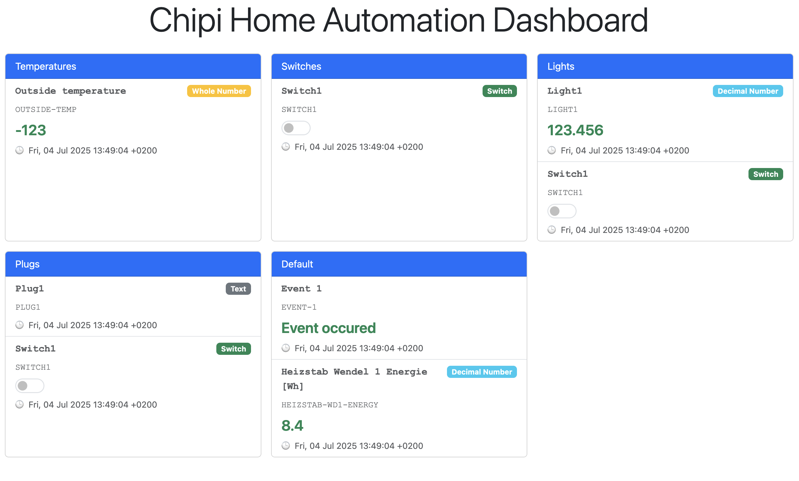
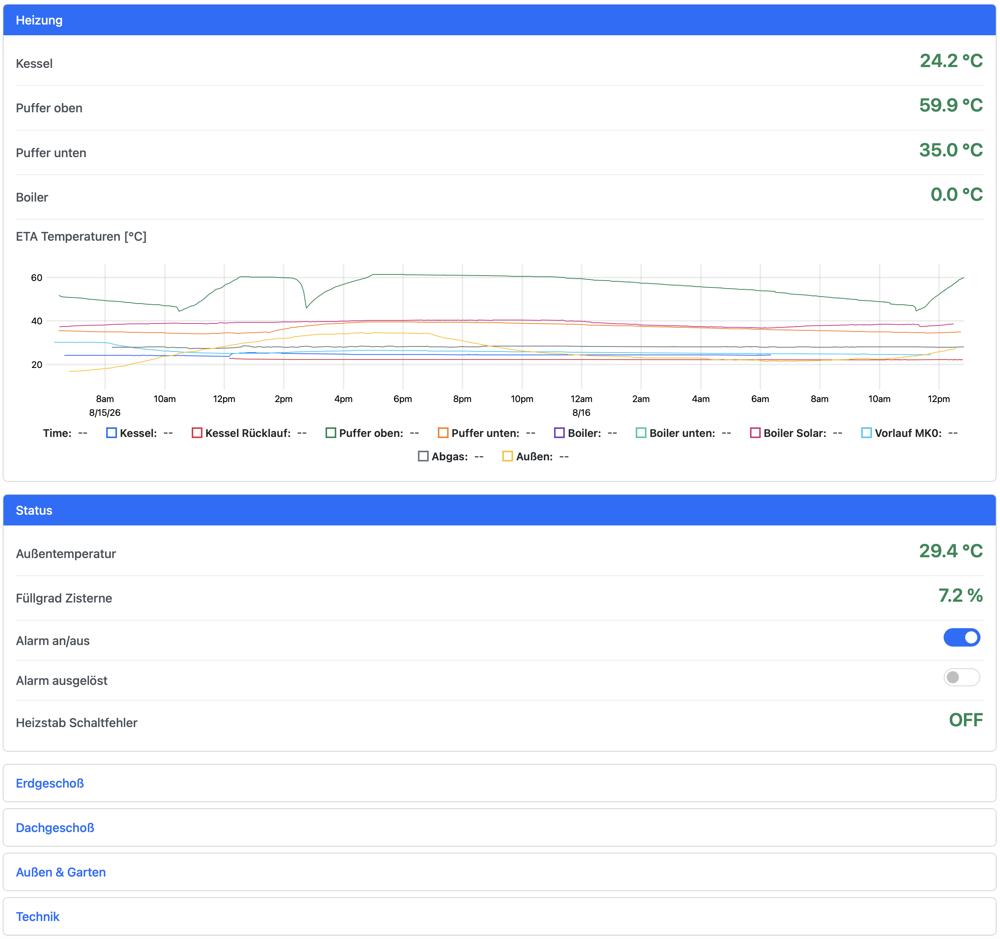

# Chipi — Home Automation in Common Lisp

Chipi is a small home automation framework. You describe your house in one
Common Lisp file — sensors, switches, where their values come from, what
should happen when they change — and Chipi runs it: polling devices, reacting
to events, storing history, and serving a web UI and a REST API on top.

It is the lightweight alternative to [openHAB](https://www.openhab.org/) for
people who would rather write a few lines of Lisp than click through a
configuration UI, and who want to change a running system from the REPL
without restarting it.

> **Status:** the core framework has been running in production 24/7 for a
> long time, driving a real house (KNX bus, heating, cistern, solar). It is
> still considered beta: APIs may change, and the web UI is under active
> development.

Licence: Apache 2.0.

---

## Contents

- [What Chipi can do](#what-chipi-can-do)
- [A complete configuration in one screen](#a-complete-configuration-in-one-screen)
- [Quick start](#quick-start)
- [Concepts](#concepts)
- [Configuration reference](#configuration-reference)
  - [The environment: `defconfig`](#the-environment-defconfig)
  - [Items](#items)
  - [Itemgroups](#itemgroups)
  - [Bindings](#bindings)
  - [Persistences](#persistences)
  - [Rules](#rules)
  - [Event log](#event-log)
  - [Changing a running system](#changing-a-running-system)
  - [Logging and shutdown](#logging-and-shutdown)
- [Web UI](#web-ui)
- [REST API](#rest-api)
- [Binding plugins](#binding-plugins)
- [Project layout and tests](#project-layout-and-tests)

---

## What Chipi can do

**Model your home as items.** An item holds one value — a temperature, a
light's on/off state, a window contact, a text message — together with a
timestamp. Items are grouped into itemgroups (rooms, floors, "all lights")
which can be nested.

**Connect items to the real world with bindings.** A binding pulls a value
from somewhere (HTTP, a serial port, a Python library, the KNX bus) on a
schedule or on an event, and pushes a new value back out when the item is set.
Plain `pull`/`push` functions cover most devices; the
[KNX binding](bindings/knx/README.md) speaks KNXnet/IP natively, with
reconnect, retried writes and optional read-back verification.

**Automate with rules.** A rule runs a function when an item changes, when an
item makes a specific transition (off → on), or on a cron schedule. Rules are
ordinary Lisp, so anything goes: send a mail, switch a pump, compute a daily
average from the history.

**Keep state and history.** A *simple* persistence saves the last value of an
item to a file and restores it on start. The *InfluxDB* persistence records
every change and lets you query ranges, with aggregates like average, min,
max, median and sum. Persistence is attached per item, on every change or at
a fixed interval. An optional event log writes every value change to a
rotating NDJSON file.

**See and control it in a browser.** The web UI (`chipi-ui`) renders an
overview of all itemgroups with zero configuration, and lets you design your
own pages with `defpage`: toggles, sliders, setpoints, selections, text and
number inputs, action buttons, and live history charts with multiple series.
Values update in real time over WebSockets. The UI installs as a web app on
phones and tablets, supports a per-device home page, and can lock a wall panel
behind a PIN.

| Auto-generated overview | A `defpage`-designed page with a chart |
|---|---|
|  |  |

**Integrate anything else over REST.** `chipi-api` exposes items and
itemgroups as JSON over HTTP, pushes changes as Server-Sent Events, and
authorises every call with scope-based API keys. An OpenAPI 3.0 spec is
included (`chipi-api.yaml`).

**Change it while it runs.** Every `def*` form can be re-evaluated against
the live system — from Emacs with `C-c C-c`, or over a Slynk/Swank connection
to a production instance. Items keep their value, rules are swapped, pages
are replaced. No restart, no reload of the whole configuration.

**Built on actors.** Chipi is based on
[Sento](https://github.com/mdbergmann/cl-gserver), a Common Lisp actor
framework. Every item, rule and persistence is an actor, which gives thread
safety, message queuing and an event bus for free, and keeps a slow device
from blocking the rest of the system.

---

## A complete configuration in one screen

This is a runnable configuration: two items, one of them polled from a
function, one of them pushing to a function, a rule tying them together, and
the web UI.

```lisp
(eval-when (:compile-toplevel :load-toplevel :execute)
  (ql:quickload :chipi-ui))          ; OCICL: (asdf:load-system :chipi-ui)

(defpackage :my-home
  (:use :cl :hab :page))
(in-package :my-home)

;; Starts the actor system, timers, cron, and creates the runtime/ folder.
;; Everything that needs a running environment goes inside.
(defconfig "chipi"
  (ui:start :host "0.0.0.0" :port 8080))

(defitemgroup 'living "Living room")

;; A temperature, polled every 60 seconds (first time after 1 second).
(defitem 'living-temp "Temperature" 'float
  :group '(living)
  (binding :initial-delay 1
           :delay 60
           :pull (lambda () (read-my-sensor))))

;; A light. Setting the item (from the UI, API or a rule) calls :push.
(defitem 'living-light "Light" 'boolean
  :initial-value 'item:false
  :group '(living)
  (binding :push (lambda (value) (switch-my-light value))))

;; Turn the light on when it gets cold.
(defrule "Light on when cold"
  :when-item-change 'living-temp
  :do (lambda (trigger)
        (let ((temp (get-item-valueq 'living-temp)))
          (when (< temp 18.0)
            (set-item-value 'living-light 'item:true)))))

;; A page for the wall tablet, served at http://<host>:8080/wall
(defpage 'wall "Wall panel"
  :path "/wall"
  (section "Living room"
    (value 'living-temp :format "~,1f °C")
    (toggle 'living-light)))
```

Load the file and open `http://localhost:8080`. The overview shows the
"Living room" group; `/wall` shows the page.

A real production configuration — items, KNX bindings, InfluxDB persistence,
rules talking to a Raspberry Pi's GPIOs via [py4cl](https://github.com/bendudson/py4cl),
a [Shelly](https://www.shelly-support.eu/) plug via
[Drakma](https://github.com/edicl/drakma) and a serial device via
[cserial-port](https://github.com/snmsts/cserial-port) — is at
[cl-eta/eta-hab.lisp](https://codeberg.org/mdbergmann/cl-eta/src/branch/master/eta-hab.lisp).

---

## Quick start

### Prerequisites

- SBCL (the implementation Chipi is developed and run on)
- [Quicklisp](https://www.quicklisp.org/) or [OCICL](https://github.com/ocicl/ocicl)
  for the dependencies
- Optional: an InfluxDB v2 instance for history and charts

### Install

Clone the repository where ASDF can find it, e.g.
`~/quicklisp/local-projects/` or `~/common-lisp/`:

```sh
git clone https://github.com/mdbergmann/chipi.git
```

Chipi consists of three ASDF systems:

| System | What it adds | Depends on |
|---|---|---|
| `chipi` | items, itemgroups, bindings, persistences, rules, event log | — |
| `chipi-api` | REST/JSON API, SSE, API keys | `chipi` |
| `chipi-ui` | web UI with pages, widgets and charts | `chipi-api` |

Load the one you need; it pulls in the ones below it:

```lisp
(ql:quickload :chipi-ui)          ; Quicklisp
(asdf:load-system :chipi-ui)      ; OCICL
```

### Try the demo

`example-web.lisp` in the project root defines a handful of items, an
in-memory history so the chart has data, a cron rule that keeps a value
moving, and two pages:

```sh
sbcl --eval '(progn (asdf:load-system "chipi-ui") (load "example-web.lisp"))'
```

Then open <http://localhost:8080> (overview), <http://localhost:8080/wall>
(a page with widgets and a chart) and <http://localhost:8080/cellar>. The
REST API listens on port 8765; the demo uses an in-memory API-key store, so
create a key at the REPL with `(apikey-store:create-apikey :access-rights '(:read :update))`.

### Write your own

Start from the configuration above or from `example-web.lisp`, keep it in
its own file, and load it the same way. Develop it from Emacs/SLIME or Sly:
every `defitem`, `defrule` and `defpage` can be re-evaluated against the
running system, see [Changing a running system](#changing-a-running-system).

---

## Concepts

| Concept | What it is | Defined with |
|---|---|---|
| **Item** | One value with a timestamp, type hint, label and tags. An actor. | `defitem` |
| **Itemgroup** | A named container of items and child groups; used for structure and for the UI overview. | `defitemgroup` |
| **Binding** | How an item's value gets in (`pull`) and out (`push`). Attached to an item. | `binding`, `knx-binding`, … |
| **Persistence** | A storage backend items write their values to and read them back from. | `defpersistence`, attached with `:persistence` |
| **Rule** | A function run on item changes, item transitions or cron schedules. | `defrule` |
| **Page** | A UI view composed of widgets, served at its own URL. | `defpage` (chipi-ui) |

Values flow like this:

```
   device/bus ──pull──▶ transform ──▶ item value ──▶ persistences
                                          │   ▲        rules
                                          │   │        UI / API / SSE
                                          ▼   │
                                 push ◀───────┘ set-value (UI, API, rule, REPL)
```

Setting an item's value — from a rule, the UI, the API or the REPL — updates
it, notifies rules and the UI, persists it, and pushes it through the item's
bindings if they allow it.

---

## Configuration reference

### The environment: `defconfig`

A configuration file is an ordinary Lisp source file. Its top usually loads
the systems in an `eval-when` so that the file can be compiled and loaded
standalone, and defines a package that `:use`s what it needs:

```lisp
(eval-when (:compile-toplevel :load-toplevel :execute)
  (ql:quickload :chipi))            ; or :chipi-api / :chipi-ui

(defpackage :my-home
  (:use :cl :hab))                  ; add :page for defpage
(in-package :my-home)
```

The first Chipi form must be `defconfig`:

```lisp
(defconfig "chipi"
  ;; optional: plugins, API and UI servers, event log
  )
```

`defconfig` starts the actor system, the timer and the cron scheduler, and
creates a `runtime/` folder in the root of the ASDF system named by its
argument (here: the `chipi` checkout). API keys, the event log and similar
runtime data live there. It is re-entrant: evaluating it again on a running
system does nothing harmful.

Anything that needs the environment up — `api-env:init`, `api:start`,
`ui:start`, `knx-init`, `event-log:ensure-event-log` — goes into its body.
Items, persistences and rules follow after it as top-level forms.

The `hab` package also offers a small runtime API for use in rules and at the
REPL:

| Function | Purpose |
|---|---|
| `(get-item 'id)`, `(get-items)` | Look up items |
| `(get-itemgroup 'id)`, `(get-items-on-group 'id)`, `(get-top-level-itemgroups)` | Look up groups |
| `(get-item-valueq 'id)` | Current value and timestamp of an item, synchronously (returns two values) |
| `(set-item-value 'id value &key push persist timestamp)` | Set an item; `:push nil` skips the bindings, `:persist nil` skips persistences |
| `(get-persistence :id)`, `(get-rule "name")` | Look up persistences and rules |
| `(add-to-shutdown fn)` | Register a function called by `shutdown` |
| `(shutdown)` | Stop everything: hooks, actors, timers, cron |

### Items

```lisp
(defitem 'myitem "My Item" 'integer)
```

The three positional arguments are the **id** (a symbol, used everywhere the
item is referenced), the **label** shown in the UI, and the **type hint**:
`'integer`, `'float`, `'boolean`, `'string`, or `nil`. The type hint is
required for the InfluxDB persistence (it decides how values are written and
parsed) and is used by the UI and API to render and convert values; it is good
practice to always give one.

Keyword options:

```lisp
(defitem 'myitem "My Item" 'integer
  :initial-value 0                 ; value at creation; default is T
  :group '(group1 group2)          ; itemgroup ids; default is the 'ch-default group
  :tags '((:ui-type . "Light")     ; alist of (key . value), free-form metadata
          (:ext-readonly . t))
  (binding ...)                    ; zero or more bindings
  :persistence '(:id :simple       ; zero or more persistence attachments
                 :frequency :every-change
                 :load-on-start t))
```

**Booleans** are represented by the symbols `item:true` and `item:false`
(not `t`/`nil`, because `nil` is a valid "no value"). The API and UI
translate them to and from JSON `true`/`false`.

**Tags** are an alist that Chipi itself does not interpret; higher layers do.
The UI understands `:ui-type`, `:ui-readonly` and `:ui-order`; the API
convention `:ext-readonly` marks an item that external clients should not
write. See [README-web.md](README-web.md) for all of them.

At runtime an item's state is read with `item:get-item-stateq` (synchronous)
or `item:get-value` (returns a future), and set with `item:set-value`; the
`hab` wrappers `get-item-valueq` and `set-item-value` take the item id
instead of the item object.

### Itemgroups

```lisp
(defitemgroup 'ground-floor "Ground floor")
(defitemgroup 'living "Living room" :group 'ground-floor)       ; nested
(defitemgroup 'lights "Lights" :tags '((:ui-link)))               ; tags, like items
```

An item can be in several groups (`:group '(living lights)`); items not
assigned to any group land in the built-in `ch-default` group. Groups are
what the UI overview renders as cards, and what the API serves under
`/itemgroups`. `itemgroup:set-value` sets every item of a group at once.

### Bindings

A binding connects an item to the outside world. The generic *function
binding* is created with `binding` inside a `defitem`:

```lisp
(defitem 'power "Power" 'float
  (binding :initial-delay 5           ; seconds until the first pull; nil = never
           :delay 60                  ; seconds between pulls; nil = no polling
           :pull (lambda () (fetch-power-over-http))
           :transform (lambda (watts) (/ watts 1000.0))
           :push (lambda (kw) (post-somewhere kw))
           :call-push-p t))
```

- **`:pull`** is a 0-argument function returning the new value. It is called
  after `:initial-delay` and then every `:delay` seconds. It may return a
  `future` if the work is asynchronous. It may also return
  `(values value '(:push nil))` to stop this particular value from being
  pushed back out, e.g. when the value just came from the device.
- **`:transform`** is applied to every pulled value before it reaches the
  item.
- **`:push`** is a 1-argument function called with the new value whenever the
  item is set — from a rule, the UI, the API, the REPL, or a pull — provided
  `:call-push-p` is true (the default). `set-item-value ... :push nil`
  skips it for one call.
- Errors in `pull` are caught and logged so that a failing device cannot take
  the timer down with it.

Both `pull` and `push` are optional, but a binding without either does
nothing. An item can have several bindings, which is useful to push one value
to several places.

Bindings for specific protocols are plugins; see
[Binding plugins](#binding-plugins).

### Persistences

A persistence is a storage backend. It is defined once at top level with an
id and a factory function, then attached to items. Chipi ships two
implementations, and a custom one is a small class with four methods
(`example-web.lisp` shows an in-memory one in a few dozen lines).

#### Simple persistence (last value, file per item)

```lisp
(defpersistence :simple
  (lambda (id)
    (simple-persistence:make-simple-persistence
     id :storage-root-path #P"/var/lib/chipi/store/")))
```

Stores the last value and timestamp of each item in its own JSON file
(`<ITEM-NAME>.store`) under the root path:

```json
{"value":66.19999694824219,"timestamp":3907315980}
```

Its purpose is to survive restarts: attach it with `:load-on-start t` and the
item starts with its stored value.

#### InfluxDB persistence (history)

```lisp
(defpersistence :influx
  (lambda (id)
    (influx-persistence:make-influx-persistence
     id
     :base-url "http://your-host:8086"
     :token "your-token"
     :org "your-org"
     :bucket "your-bucket")))
```

Writes every persisted value as a point to InfluxDB v2 and can read back
ranges, which is what charts in the UI and "average of the last 24 hours"
style rules use. Supported item types are `integer`, `float`, `boolean`
and `string`; the item's type hint must be set.

#### Attaching persistences to items

```lisp
(defitem 'cistern-level "Cistern level" 'float
  :persistence '(:id :simple
                 :frequency :every-change
                 :load-on-start t)
  :persistence '(:id :influx
                 :frequency :every-5m))
```

- **`:id`** names the persistence.
- **`:frequency`** is `:every-change`, or `:every-N<s|m|h>` for a fixed
  interval (`:every-20s`, `:every-5m`, `:every-1h`). With an interval, the
  current value is written on every tick whether it changed or not — useful
  for charts that should show flat lines rather than gaps.
- **`:load-on-start t`** restores the item's value from this persistence when
  the item is created.

#### Reading history from rules

`persp:fetch` reads from a persistence directly and returns a future:

```lisp
(persp:fetch (get-persistence :influx) (get-item 'cistern-level))               ; last value
(persp:fetch (get-persistence :influx) (get-item 'cistern-level)
             (persp:make-relative-range :days 1))                               ; list of persisted-items
(persp:fetch (get-persistence :influx) (get-item 'cistern-level)
             (persp:make-relative-range :hours 24) :avg)                        ; one aggregated value
```

Ranges are relative (`make-relative-range :seconds/:minutes/:hours/:days`,
optionally with an `:end-ts`) or absolute (`make-absolute-range start end`,
universal times). Aggregates are `:avg`, `:min`, `:max`, `:median` and
`:sum`. Results are `persp:persisted-item` structs with a value and a
timestamp.

### Rules

A rule is a function plus one or more triggers:

```lisp
(defrule "Night mode"
  :when-item-change 'motion-sensor                         ; any change of this item
  :when-item-transition '(front-door :from item:false :to item:true)
  :when-cron '(:minute 0 :hour 22)                         ; every day at 22:00
  :do (lambda (trigger)
        (case (car trigger)
          (:item
           (let* ((event (cdr trigger))
                  (item (item:item-changed-event-item event))
                  (old-value (item:item-changed-event-old-value event)))
             (log:info "~a changed from ~a" (item:name item) old-value)))
          (:cron
           (set-item-value 'all-lights 'item:false)))))
```

The `:do` function receives one argument, a cons whose `car` says what fired:

- **`:item`** — the `cdr` is an `item:item-changed-event` with the item and
  the value before the change. The new value is read from the item
  (`get-item-valueq`) or, asynchronously, with `item:get-value` and
  `future:fcompleted`.
- **`:cron`** — the `cdr` is the cron expression that fired.

Trigger kinds, each of which may be given several times per rule:

- **`:when-item-change 'id`** fires on every value change of the item.
- **`:when-item-transition '(id :from old :to new)`** fires only when the old
  and new values match. Either `:from` or `:to` can be left out to mean "any
  value". If a change matches both a transition and a plain change trigger
  of the same rule, `:do` runs once.
- **`:when-cron '(...)`** takes a plist with `:minute`, `:hour`,
  `:day-of-month`, `:month`, `:day-of-week` (each a number or `:every`, the
  default) and `:step-min`/`:step-hour`. Granularity is one minute;
  `'(:minute :every)` runs every minute. `'(:boot-only t)` runs the rule once,
  shortly after it is defined, instead of on a schedule — handy for
  initialisation work.

Rules run in their own actor, so a slow rule does not block item updates.
Because `set-item-value` on an unchanged value is a no-op, a rule that needs
to send the *same* command twice (a shutter "stop", a door opener) should call
the device function directly rather than go through an item.

### Event log

An optional log of every item value change, written as NDJSON
(one JSON object per line) to `runtime/event-log/event-log.ndjson`:

```json
{"timestamp":"2026-03-01T14:30:00.000000+01:00","item":"TEMP-SENSOR","old_value":20.0,"new_value":21.5}
```

Enable it inside `defconfig` and register its shutdown hook:

```lisp
(defconfig "chipi"
  (event-log:ensure-event-log :max-file-size (* 5 1024 1024)   ; default 10 MB
                              :max-backup-files 3)             ; default 5
  (hab:add-to-shutdown #'event-log:shutdown-event-log))
```

The file is rotated (`.1`, `.2`, …) when it exceeds the size limit. Without
`ensure-event-log` nothing is written and there is no overhead.

### Changing a running system

All `def*` forms — `defpersistence`, `defitemgroup`, `defitem`, `defrule`,
`defpage` — replace an existing definition with the same id. Re-evaluating a
form from Emacs (`C-c C-c`) or reloading the file updates the live system:

- `defitem` destroys the old item actor, re-creates it with its new bindings
  and persistence attachments, and puts it back into its groups. Use
  `:load-on-start` with a simple persistence if the value should survive.
- `defitemgroup` keeps the group's items and child groups.
- `defrule` and `defpage` are swapped in place.
- After re-evaluating a `defpersistence`, re-evaluate the items that use it,
  since they hold a reference to the old instance.

The same works against a production instance over Slynk/Swank. A `button`
widget on a page even resolves its action function by name on every click,
so redefining the function is enough.

### Logging and shutdown

Chipi logs with [log4cl](https://github.com/sharplispers/log4cl). Adjust the
level for Chipi's packages with `(log:config '(chipi) :info)`. Sento logs a
lot at `:debug`; silence it with `(log:config '(sento) :warn)`.

`(hab:shutdown)` runs the registered shutdown hooks (UI, API, event log,
plugins), stops all actors, timers and cron jobs, and clears the item, rule
and persistence registries. `(api:stop)` stops only the REST server.

---

## Web UI

`chipi-ui` is a responsive web UI built on [CLOG](https://github.com/rabbibotton/clog)
and Bootstrap 5, with real-time value updates over WebSockets. It needs no
API keys and no separate API server:

```lisp
(defconfig "chipi"
  (ui:start :host "0.0.0.0" :port 8080 :settings-pin "4711"))   ; PIN is optional
```

Two modes that can be combined:

- **Auto-generated overview** at `/`: every itemgroup becomes a card listing
  its items with the right control for the type — a toggle for booleans, a
  value for sensors, inputs for strings and numbers. Zero configuration;
  tags like `:ui-type`, `:ui-readonly`, `:ui-order` and `:ui-link` fine-tune
  it.
- **Pages** with `defpage`: views you compose from widgets, each served at
  its own URL, so a wall tablet bookmarks `/wall` and a phone `/mobile`.

```lisp
(defpage 'heating "Heating"
  :path "/heating"
  :title "Heating"
  (section "Boiler"
    (value 'boiler-temp :format "~,1f °C")
    (setpoint 'target-temp :min 15.0 :max 25.0 :step 0.5)
    (chart '((boiler-temp . "Boiler") (buffer-top . "Buffer top"))
           :range '(:hours 12)))
  (row (section "Pump" (toggle 'pump))
       (section "Mode" (selection 'mode :choices '(("auto" . "Auto") ("off" . "Off")))))
  (page-link 'cellar))
```

Widgets: `value`, `toggle`, `text-input`, `number-input`, `slider`,
`setpoint`, `selection`, `chart`, `button`/`button-group`, `section`, `row`,
`page-link`, `itemgroup-ref`. Charts read their history from a historic
persistence (InfluxDB) and append live values; they support several series,
bar or line, fill, a second y-axis, transforms and custom ranges.

Beyond that the UI offers per-device settings (home page), a device lock
behind a server-side PIN for wall panels, browser history navigation that
restores views as they were left, and installation as a web app on iOS,
Android and desktop.

The full UI documentation — pages, every widget and its options, charts,
settings, locking, installing, UI tags — is in
[README-web.md](README-web.md#chipi-ui).

---

## REST API

`chipi-api` adds a JSON API over HTTP (Hunchentoot + Snooze), authorised with
scope-based API keys:

```lisp
(defconfig "chipi"
  (api-env:init :apikey-store (apikey-store:make-simple-file-backend)
                :apikey-lifetime (ltd:duration :day 100))
  (api:start))                                     ; port 8765

;; create a key once, e.g. at the REPL; keys are stored in runtime/apikeys
(apikey-store:create-apikey :access-rights '(:read :update))
```

| Endpoint | Method | Scope |
|---|---|---|
| `/items`, `/items/{name}` | GET | `read` |
| `/items/{name}` | POST `{"value": ...}` | `update` |
| `/itemgroups`, `/itemgroups/{name}` | GET | `read` |
| `/events/items` | GET (Server-Sent Events) | `read` |

```sh
curl -H "X-Api-Key: $KEY" http://localhost:8765/items/lamp
curl -X POST -H "X-Api-Key: $KEY" -H "Content-Type: application/json" \
     -d '{"value": true}' http://localhost:8765/items/lamp
curl -H "Accept: text/event-stream" "http://localhost:8765/events/items?apikey=$KEY"
```

The SSE stream delivers every item change with the full item as JSON, plus
heartbeats. The OpenAPI specification is in `chipi-api.yaml`; the details —
scopes, key persistence, event payloads, timestamps — are in
[README-web.md](README-web.md).

---

## Binding plugins

### KNX

The [KNX binding](bindings/knx/README.md) connects items to KNX group
addresses over KNXnet/IP tunnelling. It listens to the bus and updates items
asynchronously, writes item changes back to the bus, converts values
according to the group address's DPT, reconnects with backoff, retries
writes, and can verify a write by reading the actuator's status back:

```lisp
(defconfig "chipi"
  (knx-init :gw-host "192.168.1.23"))

(defitem 'kitchen-light "Kitchen light" 'boolean
  (knx-binding :ga '(:read "1/2/3" :write "1/2/4")
               :dpt "1.001"
               :initial-delay 2
               :call-push-p t))
```

The plugin lives in `bindings/knx/` and is loaded as its own ASDF system
(`binding-knx`); see its README for setup, DPTs and the verify policy.

### Writing your own

For most devices a function binding with `:pull`/`:push` lambdas is all that
is needed — HTTP via Drakma, a serial port, a shell command, py4cl. A reusable
binding for a protocol is a subclass of `binding:binding` that creates a
`binding` instance with its own pull/push functions and keeps its connection
state; the KNX binding is the reference implementation.

---

## Project layout and tests

```
src/                core: item, itemgroup, binding-api, persistence-*, rule, cron, timer, env, event-log, hab (DSL)
src/api/            chipi-api: controllers, API-key store, SSE
src/ui/             chipi-ui: defpage DSL, widgets, renderer, settings
ui/static-files/    CSS, icons, vendored jQuery/Bootstrap/uPlot (no internet needed)
bindings/knx/       KNX binding plugin with its own README and tests
test/, test/api/, test/ui/   FiveAM test suites
example-web.lisp    runnable demo configuration (UI + API)
chipi-api.yaml      OpenAPI 3.0 spec of the REST API
```

Tests use FiveAM and cl-mock:

```lisp
(asdf:test-system :chipi)
(asdf:test-system :chipi-api)
(asdf:test-system :chipi-ui)
```

Main dependencies: [Sento](https://github.com/mdbergmann/cl-gserver) ≥ 3.4.2,
cl-cron, timer-wheel, com.inuoe.jzon, Drakma, local-time; Hunchentoot and
Snooze for the API; CLOG for the UI. All are available through Quicklisp and
OCICL.
